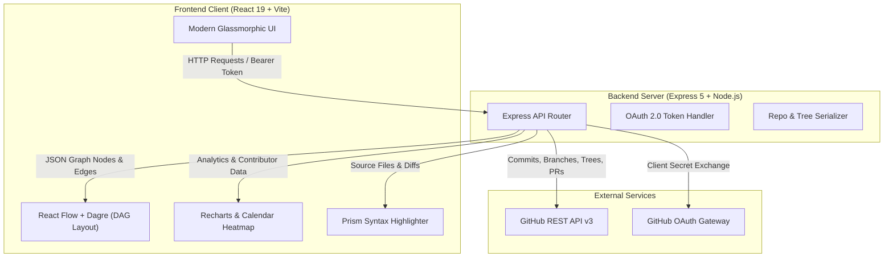
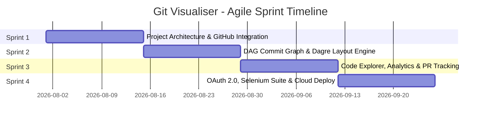

# 🌐 Git Visualiser

<p align="center">
  <strong>A modern, interactive full-stack web dashboard to visualize, analyze, and inspect the evolution of Git repositories.</strong>
</p>

<p align="center">
  <a href="#-key-features"></a>
  <a href="#-key-features"></a>
  <a href="#-key-features"></a>
  <a href="#-key-features"></a>
  <a href="#-key-features"></a>
  <a href="#-automated-testing-selenium--pytest"></a>
  <a href="#-automated-testing-selenium--pytest"></a>
  <a href="#-deployment"></a>
  <a href="#-deployment"></a>
</p>

---

## 📖 Table of Contents

- [Overview](#-overview)
- [Key Features](#-key-features)
- [System Architecture](#-system-architecture)
- [Tech Stack](#-tech-stack)
- [Repository Structure](#-repository-structure)
- [Getting Started](#-getting-started)
  - [Prerequisites](#prerequisites)
  - [1. Backend Setup](#1-backend-setup)
  - [2. Frontend Setup](#2-frontend-setup)
  - [3. GitHub OAuth Configuration](#3-github-oauth-configuration)
- [API Reference](#-api-reference)
- [Automated Testing (Selenium & Pytest)](#-automated-testing-selenium--pytest)
- [Software Engineering & Metrics Analysis](#-software-engineering--metrics-analysis)
  - [Agile Methodology](#agile-scrum-methodology)
  - [COCOMO & Software Estimation](#software-metrics-summary)
- [Deployment](#-deployment)
- [Roadmap & Future Improvements](#-roadmap--future-improvements)
- [Contributors](#-contributors)
- [License](#-license)

---

## 🔎 Overview

**Git Visualiser** is an end-to-end web application developed to bridge the gap between raw, terminal-based `git log` output and intuitive visual comprehension. Designed for developers, engineering managers, and educators, it transforms complex branch topologies, commit histories, contributor patterns, and file changes into an interactive graphical experience.

Instead of parsing through terminal hashes and manual diffs, **Git Visualiser** delivers:
- Hierarchical **Directed Acyclic Graph (DAG)** branch & merge visualization.
- Interactive **Time-Travel Timeline** playback reconstructing project history step-by-step.
- Integrated **In-Browser Code Explorer** with syntax highlighting.
- High-resolution **Contributor Analytics** and GitHub-style **Commit Activity Heatmaps**.
- Direct commit inspection with live file diffs and GitHub Pull Request tracking.

Developed as a major capstone for **PBL III: Software Engineering and Modelling (SEM)**, the project pairs modern full-stack web engineering with rigorous software engineering practices, including automated end-to-end Selenium validation, COCOMO effort estimation, and Agile sprint planning.

---

## ✨ Key Features

### 🌳 1. Interactive Network Graph (DAG)
- **Automatic Graph Layout**: Powered by `@xyflow/react` and Dagre graph library, calculating top-to-bottom hierarchical layouts.
- **Visual Branch Semantics**: Automatically identifies and applies color-coded badges to commits:
  - 🔵 `HEAD` (Active tip)
  - 🟣 `feature/*` / `feat/*`
  - 🔴 `fix/*` / `bug/*`
  - 🟢 `origin/*` (Remote tracking branches)
- **Node Interactivity**: Drag, pan, zoom, minimap overview, and clickable nodes to reveal commit details.

### ⏱️ 2. Time-Travel Timeline (Auto-Play)
- Animate repository construction from the initial commit up to `HEAD`.
- Step through commits at adjustable intervals to observe how branches diverge and merge over time.

### 🔍 3. Instant Search & Highlighting
- Real-time search by **commit message**, **author name**, or **commit hash**.
- Non-matching nodes gracefully dim, while matching nodes illuminate with a glowing highlight.

### 📂 4. In-Browser Code Explorer
- Recursively explore the repository file tree on any active branch.
- View source code directly inside the application with syntax highlighting powered by Prism (`react-syntax-highlighter`).

### 📊 5. Contributor Analytics & Heatmap
- **Annual Contribution Heatmap**: Visual calendar heatmap displaying commit frequency over the past 365 days.
- **Commit Activity Area Chart**: Smooth responsive timeline chart tracking commit velocity over time.
- **Top Contributors Leaderboard**: Dynamic ranking of top committers with profile avatars and commit totals.

### 🔀 6. Commit Diff & Pull Requests
- Inspect detailed commit metadata, exact timestamp, author avatar, and modified file summaries.
- Code diff viewer rendering line insertions and deletions.
- Dedicated **Pull Requests** tab listing open, closed, and merged PRs with direct links.

### 🔐 7. GitHub OAuth 2.0 Integration
- One-click GitHub authentication.
- Seamlessly access private repositories and unlock elevated GitHub API rate limits (5,000 requests/hr vs. 60 requests/hr unauthenticated).

### 🌓 8. Glassmorphic Dark & Light Themes
- Tailored GitHub-inspired Dark mode and clean Light mode.
- Smooth transitions, responsive drawer panels, and modern typography.

---

## 🏗️ System Architecture



---

## 🛠️ Tech Stack

| Layer | Technology | Description |
|---|---|---|
| **Frontend Framework** | [React 19](https://react.dev/) | Component architecture, hooks, and responsive state |
| **Frontend Tooling** | [Vite 8](https://vitejs.dev/) | Ultra-fast HMR and optimized production bundle |
| **Graph Visualization** | [@xyflow/react](https://reactflow.dev/) (React Flow) | Node-edge graph rendering with pan/zoom/minimap |
| **Graph Layout Engine** | [Dagre](https://github.com/dagrejs/dagre) | Directed graph layout algorithm for DAGs |
| **Data Analytics** | [Recharts](https://recharts.org/) & `react-calendar-heatmap` | Commit activity graphs and contribution heatmaps |
| **Syntax Highlighting** | [React Syntax Highlighter](https://github.com/react-syntax-highlighter/react-syntax-highlighter) | Code viewer with Prism dark/light themes |
| **Animations & Icons** | [Framer Motion](https://www.framer.com/motion/) & [Lucide React](https://lucide.dev/) | Smooth transitions and modern UI icons |
| **Backend Runtime** | [Node.js 18+](https://nodejs.org/) & [Express 5](https://expressjs.com/) | RESTful API server and authentication proxy |
| **API Client** | [Axios](https://axios-http.com/) | Promise-based HTTP client for GitHub REST API v3 |
| **Testing Suite** | [Selenium WebDriver 4](https://www.selenium.dev/) & [Pytest 8](https://docs.pytest.org/) | End-to-end automated UI, responsiveness, and functional testing |
| **Deployment** | [Vercel](https://vercel.com/) (Frontend) & [Render](https://render.com/) (Backend) | Cloud continuous delivery |

---

## 📁 Repository Structure

```text
git_visualiser/
├── backend/
│   ├── index.js                  # Express 5 server & GitHub REST API routes
│   ├── package.json              # Backend dependencies (express, axios, cors, dotenv)
│   ├── .env.example              # Template for server environment variables
│   └── temp_repos/               # Temporary workspace directory
├── frontend/
│   ├── src/
│   │   ├── App.jsx               # Main visualizer component & tab views
│   │   ├── App.css               # Component layout styles
│   │   ├── index.css             # Design tokens, themes (dark/light), and variables
│   │   └── main.jsx              # React 19 entry point
│   ├── package.json              # Frontend dependencies (React Flow, Recharts, Vite)
│   ├── vite.config.js            # Vite configuration
│   └── vercel.json               # SPA routing rewrite rule for Vercel
└── README.md                     # Root project documentation
```

---

## 🚀 Getting Started

### Prerequisites

Ensure you have the following installed:
- [Node.js](https://nodejs.org/) (v18.0.0 or higher)
- [npm](https://www.npmjs.com/) (v9.0.0 or higher)
- [Python](https://www.python.org/) (v3.8+ required only for running the Selenium test suite)
- [Google Chrome](https://www.google.com/chrome/) or another modern web browser

---

### 1. Backend Setup

1. Open a terminal and navigate to the `backend` folder:
   ```bash
   cd backend
   ```

2. Install backend dependencies:
   ```bash
   npm install
   ```

3. Configure environment variables:
   ```bash
   cp .env.example .env
   ```
   Edit `.env` with your preferred settings:
   ```env
   PORT=3001
   FRONTEND_URL=http://localhost:5173
   GITHUB_CLIENT_ID=your_github_client_id_here
   GITHUB_CLIENT_SECRET=your_github_client_secret_here
   # Optional: add a personal access token for higher unauthenticated rate limits
   GITHUB_TOKEN=
   ```

4. Start the backend server:
   ```bash
   npm run dev
   ```
   The backend will be live at `http://localhost:3001`.

---

### 2. Frontend Setup

1. Open a second terminal and navigate to the `frontend` folder:
   ```bash
   cd frontend
   ```

2. Install frontend dependencies:
   ```bash
   npm install
   ```

3. (Optional) Configure environment variables:
   If your backend is running on a port other than 3001, create a `.env` file in `frontend`:
   ```env
   VITE_API_BASE_URL=http://localhost:3001/api
   ```

4. Start the Vite development server:
   ```bash
   npm run dev
   ```
   The application will be accessible at **`http://localhost:5173`**.

---

### 3. GitHub OAuth Configuration

To enable GitHub login for private repository access:
1. Go to your [GitHub Developer Settings](https://github.com/settings/developers) > **OAuth Apps** > **New OAuth App**.
2. Set the fields:
   - **Application Name**: `Git Visualiser`
   - **Homepage URL**: `http://localhost:5173`
   - **Authorization callback URL**: `http://localhost:3001/api/auth/github/callback`
3. Generate a **Client Secret**.
4. Copy the **Client ID** and **Client Secret** into your `backend/.env` file.
5. Restart your backend server.

---

## 📡 API Reference

All backend endpoints are prefixed with `/api`.

| Method | Endpoint | Query / Body Params | Description |
|---|---|---|---|
| `GET` | `/auth/github` | — | Initiates GitHub OAuth authentication redirect |
| `GET` | `/auth/github/callback` | `code` | Exchanges authorization code for access token |
| `GET` | `/auth/user` | *(Bearer token in header)* | Fetches authenticated user profile & avatar |
| `POST` | `/repo/clone` | `{ "url": "...", "sessionId": "..." }` | Validates repository accessibility on GitHub |
| `GET` | `/repo/graph` | `repoName=owner/repo` | Returns node DAG, commit edges, and analytics timeline |
| `GET` | `/repo/info` | `repoName=owner/repo` | Fetches stars, forks, language, and repository metadata |
| `GET` | `/repo/tree` | `repoName=owner/repo&branch=main` | Retrieves recursive file hierarchy for Code Explorer |
| `GET` | `/repo/file` | `repoName=owner/repo&path=src/index.js` | Retrieves file content decoded with syntax highlighter |
| `GET` | `/repo/prs` | `repoName=owner/repo` | Retrieves recent open and merged pull requests |
| `GET` | `/repo/contributors` | `repoName=owner/repo` | Retrieves top contributors with commit counts and avatars |
| `GET` | `/repo/diff/:hash` | `repoName=owner/repo` | Returns commit file stats and raw unified diff |

---

## 🧪 Automated Testing (Selenium & Pytest)

The project includes an enterprise-grade automated test suite written in Python using Selenium WebDriver, supporting both `unittest` and `pytest`.

### 1. Install Test Dependencies

```bash
pip install -r selenium_requirements.txt
```

### 2. Run with Pytest (Recommended)

Generate comprehensive self-contained HTML test and coverage reports:

```bash
# Ensure both backend (3001) and frontend (5173) are running
pytest
```

To run in headless mode (ideal for CI/CD):
```bash
HEADLESS=1 pytest
```

### 3. Run with Python `unittest`

```bash
# Run all tests
python test_git_visualizer.py

# Run with verbose output
python -m unittest -v test_git_visualizer
```

### 4. Test Coverage Summary

- ✅ **UI Verification**: Page layout, sidebar components, branding, responsive canvas.
- ✅ **Navigation**: Smooth tab transitions across Overview, Network Graph, Code Explorer, Pull Requests, Analytics.
- ✅ **Theme Toggle**: Real-time switching between Light and Dark mode styles.
- ✅ **Interactive Search**: Commit message, author, and hash query filtering.
- ✅ **Time-Travel Feature**: Timeline playback toggle and animation verification.
- ✅ **Code & Diff Inspection**: Modal panels, commit metadata, and syntax inspection.
- ✅ **Responsive Testing**: Multi-resolution validation (1920×1080, 1366×768, 1024×768, 800×600).
- ✅ **Error Handling**: Graceful degradation on invalid repository URLs and network disconnects.

---

## 📐 Software Engineering & Metrics Analysis

Developed under the curriculum of **PBL III: Software Engineering and Modelling (AY 26-27, SEM V, TY CSE)**.

### Agile Scrum Methodology

The project was executed across four structured sprints:



- **Sprint 1**: Problem definition, SRS documentation, GitHub REST API proxying, and core layout design.
- **Sprint 2**: Directed commit graph rendering with React Flow, Dagre DAG layout calculations, and branch tag parsing.
- **Sprint 3**: In-browser file tree explorer with syntax highlighter, Recharts commit trends, contribution calendar heatmap, and commit diff inspector.
- **Sprint 4**: GitHub OAuth 2.0 authentication, dark/light theme toggle, Selenium & Pytest automation suite, and deployment on Vercel + Render.

### Software Metrics Summary

| Metric | Analysis Model | Calculated Value |
|---|---|---|
| **Project Size** | Physical LOC | **507 LOC** (0.507 KLOC) |
| **Effort (COCOMO I)** | Organic Mode ($E = 2.4 \times KLOC^{1.05}$) | **1.18 Person-Months** |
| **Development Time (COCOMO I)** | Organic Mode ($D = 2.5 \times E^{0.38}$) | **2.66 Months** |
| **Team Size** | 4-Person Engineering Team | Actual duration: **~0.30 Months (~1.2 Weeks)** |
| **Effort (COCOMO II)** | Post-Architecture Model ($E = A \times Size^E \times \prod EAF$) | **1.22 Person-Months** |
| **Function Points (FPA)** | 5 Core Transaction/Data Functions ($FP = UFP \times VAF$) | **55.9 Unadjusted / 58.7 Adjusted FP** |
| **PERT Scheduling** | Three-point estimation ($T_e = \frac{O + 4M + P}{6}$) | **Critical path: 22.8 working days** |

---

## 🌐 Deployment

### Frontend (Vercel)
- Configured with `frontend/vercel.json` to handle client-side Single Page Application (SPA) routing:
  ```json
  {
    "rewrites": [{ "source": "/(.*)", "destination": "/index.html" }]
  }
  ```
- Set `VITE_API_BASE_URL` in Vercel environment variables pointing to your Render backend instance.

### Backend (Render)
- Deploy as a **Web Service** with Node runtime:
  - **Build Command**: `npm install`
  - **Start Command**: `node index.js`
- Set environment variables in the Render dashboard:
  - `FRONTEND_URL`: Your Vercel domain URL
  - `GITHUB_CLIENT_ID` & `GITHUB_CLIENT_SECRET`: OAuth app credentials

---

## 🔮 Roadmap & Future Improvements

- [ ] **Multi-User Concurrency**: Transition from shared state to isolated session workspaces with unique session tokens (`temp_repos/<session_id>`).
- [ ] **Canvas / WebGL Graph Rendering**: Integrate Cytoscape.js or Vis.js to seamlessly render ultra-large repositories (>10,000 commits) without DOM bottlenecks.
- [ ] **Automated Disk Hygiene**: Background cron daemon to prune temporary clone folders and mitigate disk exhaustion.
- [ ] **Branch Comparison Matrix**: Side-by-side visual branch comparison displaying divergent commits and visual merge conflict risk analysis.

---

## 📄 License

This project is licensed under the [ISC License](https://opensource.org/licenses/ISC).
